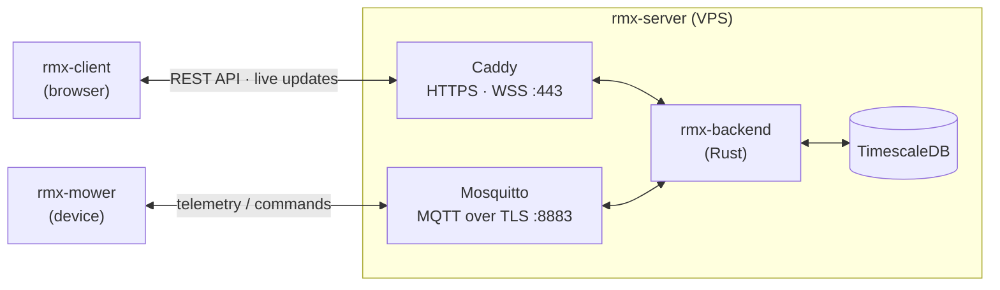

# Blade of Grass

An open source **robotic lawn mower** project: the mower, a cloud server it talks to, and a client app to watch and control it.

This is the **meta repository**. It holds the overview and architecture, and links to the component repos where the code lives.

## Components

| Part | Repo | What it is | Status |
|---|---|---|---|
| **rmx-server** | [rmx-vps](https://github.com/jRmx0/rmx-vps) | Server infrastructure: hardened Ubuntu VPS, Docker Compose, Caddy (HTTPS, secure WebSockets), Mosquitto (MQTT over TLS) | ✅ Running |
| | [rmx-backend-probe](https://github.com/jRmx0/rmx-backend-probe) | Learning / diagnostic Rust service: a minimal MQTT → Postgres → HTTP/WSS stack that rehearses the backend toolchain and tests the server end to end | 🔜 Next |
| | [rmx-backend](https://github.com/jRmx0/rmx-backend) | Production Rust backend: telemetry ingest, TimescaleDB storage, REST/WebSocket API, serves rmx-client | 📋 Planned |
| **rmx-mower** | [rmx-mower](https://github.com/jRmx0/rmx-mower) | Mower firmware: sensors, motion and blade control, MQTT link to the server | 📋 Planned |
| **rmx-client** | [rmx-client](https://github.com/jRmx0/rmx-client) | Client app to monitor and control the mower, served by rmx-backend | 📋 Planned |

## Architecture



- **Mower ↔ server:** MQTT over TLS. Each mower has its own login and may only use its own topics (`mower/<id>/…`): telemetry, online status (last will), commands and command acknowledgements.
- **Client ↔ server:** HTTPS for the REST API and the client app itself, plus secure WebSockets for live updates. Browsers never talk to the MQTT broker directly.
- **Inside the server:** every service runs in Docker. The database sits on an internal network that only the backend can reach.
- **Safety lives on the mower.** It stops by itself if the connection or command acknowledgements are lost, and never relies on the server to stop the blades.

## Public endpoints

| Endpoint | Protocol | Purpose |
|---|---|---|
| `https://rmx.lt` | HTTPS | Website / client app |
| `https://api.rmx.lt` | HTTPS, WSS | Backend API and live updates |
| `mqtt.rmx.lt:8883` | MQTT over TLS | Mower connections (login required) |

## Local layout

The component repos are cloned next to this one. This repo's `.gitignore` excludes their folders:

```
blade-of-grass/            ← this repo
├── rmx-server/
│   ├── rmx-vps/
│   ├── rmx-backend-probe/
│   └── rmx-backend/
├── rmx-mower/
└── rmx-client/
```
